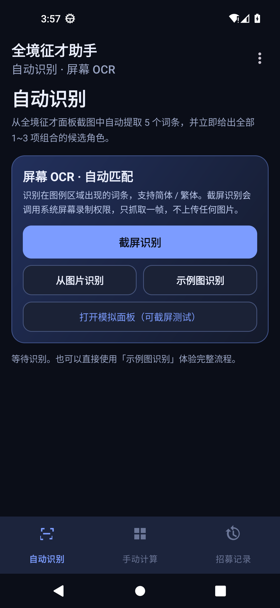

# 全境征才助手（TKFM Recruit Assistant）

《天下布魔》全境征才的离线计算器与游戏内助手。Android 原生实现（Java + AndroidX + ML Kit 中文 OCR），**无网络权限、无广告、无账号**，角色与词条数据全部随包内置。

- **游戏内助手**：悬浮球 + 半屏结果窗；点结果角色自动改选词条、把招募时间调到 09:00，可选自动点「开始招募」
- **自动识别**：截图 / 相册 / 内置示例 → 中文 OCR 提取最多 5 个词条 → 自动匹配
- **手动计算**：33 个词条任选 ≤5 个，实时枚举 1~3 项组合
- **精确规则**：领袖门槛、菁英优先、同角色列表去重
- **招募记录**：本机保存最近 80 次分析，可恢复 / 清空



## 下载

在仓库右侧的 **Releases** 页面下载最新 `*-release.apk`（已签名，minSdk 23 / Android 6.0+），校验值随 Release 说明提供。

```bash
adb install -r 全境征才助手-x.y.z-release.apk
```

## 使用

### 游戏内助手（推荐）

1. 打开「自动识别」页，点「启动游戏内助手」，按系统提示授权一次屏幕录制。
2. 首次使用需到系统设置开启无障碍服务：**全境征才助手 · 游戏内助手**。
3. 进入游戏的全境征才页面，点右侧悬浮球；识别成功后底部弹出半屏结果。
4. 点结果里的任意角色：自动补选 / 取消词条，并把招募时间按最短路径调到 09:00（当前小时 <5 时点下箭头，01 下点一次即回绕到 09；≥5 时点上箭头）；**招募键默认不自动按**。
5. 结果窗可滚动；顶部可切换点击间隔（100 / 150 / 250 / 400 ms）。
6. 「助手设置」可分别开关：自动点选词条、自动调整时间、自动点击「开始招募」。前两项默认开启，**自动开始招募默认关闭**，开启时会二次确认，因为会消耗游戏资源。
7. 通知栏「停止助手」可结束本次录屏会话。
8. 真我 / OPPO 等厂商 ROM：先点「真我 / OPPO 后台运行设置」，在耗电管理里允许后台活动，否则系统可能在一次识别后中断录屏会话。

### 截图 / 相册识别（备用，无需无障碍）

1. 「截屏识别」：授权屏幕录制后 3 秒内切到游戏的全境征才页面。
2. 「从图片识别」：选择已有截图；「示例图识别」「模拟面板」可零权限体验。
3. 「手动计算」：在词条库中点选 1~5 个词条，结果实时更新。
4. 结果含义：`必出` = 该组合唯一候选；`推荐` = 全 SR 以上且多候选。点角色查看其词条与必出组合。
5. 「记录」：自动识别（5 词条成功）与手动保存都会写入本机，点击记录可恢复词条。

## 构建

环境：JDK 17+、Android SDK 35、Gradle 8.14.4（wrapper 已附带）。

```bash
# 新建 local.properties
sdk.dir=/path/to/Android/Sdk

./gradlew :app:assembleDebug
./gradlew :app:testDebugUnitTest
```

Windows 下：

```bat
gradlew.bat :app:assembleDebug
gradlew.bat :app:testDebugUnitTest
```

> AGP 对包含非 ASCII 字符的工程路径支持不稳定。若构建报 `Invalid file path`，请把工程复制到纯英文路径再构建。

### 签名 Release

Release 构建从根目录 `keystore.properties` 读取签名信息，文件格式见 [`keystore.properties.example`](keystore.properties.example)。该文件与 keystore 均已在 `.gitignore` 中，请自行生成并妥善保管：

```bash
keytool -genkeypair -v -keystore keystore/release.jks -alias release \
        -keyalg RSA -keysize 2048 -validity 10000
```

未提供 `keystore.properties` 时，Release 构建产出的是未签名 APK，Debug 构建不受影响。

## 匹配算法

- 枚举已选词条的 1~3 项组合；
- 角色必须包含组合中的全部词条；
- 组合不含「领袖」时排除全部 3★ 角色；
- 相同角色列表合并，含「菁英」的组合优先，再取最短组合；
- 评分：

```text
score = SSR?100000 : SR?10000 : R?1000
      + (候选数==1 ? 200 : 全SR+?100 : 0)
      + (srCount==0 ? -候选数 : srCount/候选数)
```

## 工程结构

```text
app/src/main/java/com/tkfm/recruitassistant/
├─ MainActivity.java                  三 Tab + 菜单
├─ AssistantAccessibilityService.java 游戏内助手：OCR、点选、手势
├─ AssistantOverlay.java              悬浮球 + 半屏结果窗
├─ ProjectionService.java             常驻 MediaProjection 会话
├─ DemoPanelActivity.java             模拟全境征才面板（验证助手）
├─ CaptureService.java                一次性抓帧（前台服务）
├─ core/                              词条、角色、匹配、OCR、记录、点选计划
├─ ui/                                自动 / 手动 / 记录页、结果渲染、规则
└─ util/Ui.java
app/src/main/res/xml/assistant_service_config.xml   无障碍服务配置
app/src/main/assets/
├─ tags.json                          33 个词条
├─ characters.json                    77 名角色
└─ sample_recruit.jpg                 示例截图
app/src/test/                         算法与点击序列单元测试
```

## 已知限制

- 录屏会话依赖常驻虚拟屏与前台服务；真我 / OPPO 等 ROM 需允许后台活动，否则可能被中断并要求重新授权。
- 自动点选依赖游戏 UI 的 OCR 坐标与「选中态左侧深色像素」判断；游戏改版、分辨率或主题变化可能导致失效。
- 招募时间目标固定为 **09:00**；若规则变化需调整 `AutoSelectPlanner`。
- 自动点击「开始招募」默认关闭；按钮通过整图 + 底部高分辨率二次 OCR 定位，游戏弹二次确认框时不会自动处理。
- 结果角色只显示 `★ + 名称` 文本，没有头像 / 稀有度排版。
- APK 约 48 MB（ML Kit 中文模型 + 多 ABI），首次 OCR 需 1~3 秒加载模型。

## 声明

- 本应用为独立的、非官方的个人项目，与游戏运营方及任何其他第三方工具作者均无关联。
- 角色与词条数据整理自公开资料，相关版权归游戏运营方所有。
- 本工具仅供学习与个人查询使用。使用截图、无障碍与自动点击功能时，请自行确认并遵守游戏服务条款；由此产生的风险由使用者承担。

## License

[MIT](LICENSE)
